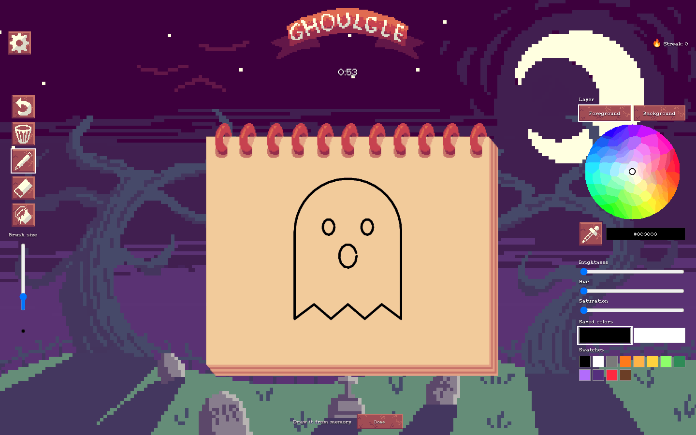
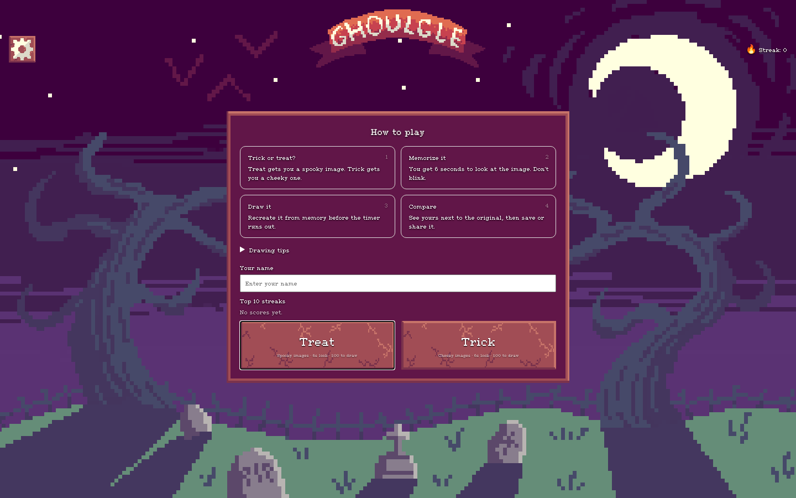
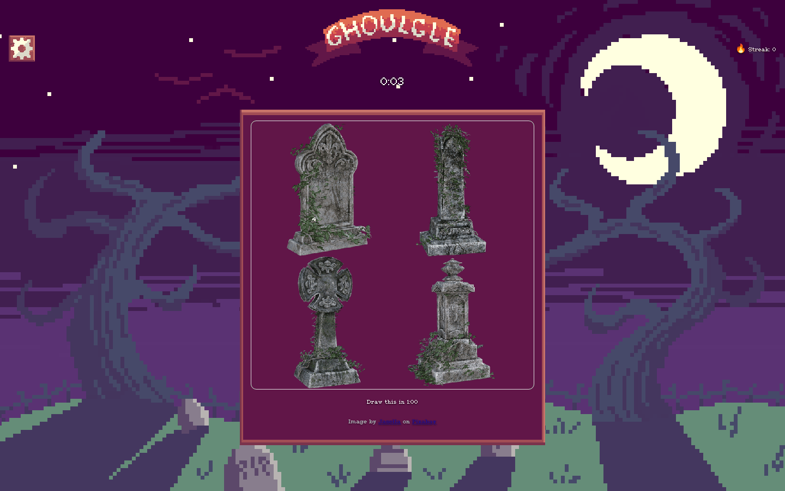

<p align="center">
  
</p>

<h3 align="center">A spooky draw-it-from-memory game, judged by a sarcastic AI.</h3>

<p align="center">
  <a href="https://geckoboy-jo.github.io/AOEProject/"><b>Play it live</b></a>
  ·
  <a href="#how-to-play">How to play</a>
  ·
  <a href="#betelgeuse-the-judge">Betelgeuse</a>
  ·
  <a href="#run-it-locally">Run it locally</a>
</p>

<p align="center">
  
</p>

---

## How to play

1. **Trick or treat?** Pick **Treat** for a spooky image or **Trick** for a goofy one.
2. **Memorize it.** The image shows for 6 seconds. Don't blink.
3. **Draw it.** Recreate it from memory before the 1:00 timer runs out.
4. **Face the judge.** See your drawing next to the original, get scored, and find out what Betelgeuse thinks of your work.

<p align="center">
  
  &nbsp;
  
</p>

## Trick or treat

The theme runs through the whole game:

- **Treat** is the fair game: spooky Halloween clipart (jack-o'-lanterns, ghosts, bats, cauldrons) with simple shapes you can actually remember.
- **Trick** looks the same but plays dirty: goofy Halloween images, and about **1 in 3 Trick rounds ambushes you with a famous painting**. Six seconds to memorize *The Garden of Earthly Delights*, one minute to draw it. The results screen tells you exactly which masterpiece you just butchered.

The ambush paintings are all public domain: Bosch, Bruegel, Goya, Munch, Fuseli, Böcklin, Hokusai, Van Gogh, Seurat and more.

## Betelgeuse, the judge

Every drawing gets two scores:

- **An instant score**, computed in your browser by comparing your drawing's colors and layout to the original.
- **Betelgeuse's verdict**, from **[Gemma 4](https://ai.google.dev/gemma)**, Google's open-weight model (`gemma-4-26b-a4b-it`). Betelgeuse looks at your drawing *and* the original, scores how well you captured the idea (not artistic skill), and roasts you in 25 words or fewer.

Betelgeuse runs through a small [Cloudflare Worker](worker/) so the API key never touches the browser. The Worker is rate-limited per player, and if it's unreachable the game keeps working without the judge.

## Features

- **Drawing tools:** brush, eraser, bucket fill, eyedropper, foreground/background layers, color wheel with hue/saturation/brightness, saved colors and swatches, live brush-size preview
- **Shortcuts:** <kbd>Ctrl</kbd>/<kbd>⌘</kbd> + <kbd>Z</kbd> to undo, <kbd>Ctrl</kbd>/<kbd>⌘</kbd> + <kbd>S</kbd> to save
- **Scoreboards:** a top-10 streak board plus a top-10 board for every image, shared between players through the Worker (stored locally when offline)
- **Streaks:** consecutive rounds scoring 50 or higher
- **Save and share** your drawing from the results screen
- Pixel-art UI, backdrop and font, made for the game

## Built on open source

Ghoulgle is a fork of **[drawing-app](https://github.com/sudipt1999/drawing-app)** by Sudipt Dabral, a small HTML/CSS/JS canvas drawing app from 2019. We kept its canvas and turned it into a game. Everything else is new: the round flow, the image pipeline, the judge, the scoreboards, the drawing tools and the pixel-art UI.

## Run it locally

No build step. It's a static site:

```bash
git clone https://github.com/Geckoboy-jo/AOEProject.git
cd AOEProject
python3 -m http.server 8000
```

Then open <http://localhost:8000>.

Opening `index.html` directly (`file://`) works too, but browsers block the judge and the shared scoreboards there, so use the local server to get Betelgeuse.

## Project layout

```
index.html              the whole game (four screens: start, preview, draw, results)
css/                    layout + game screens
js/
  game.js               round flow, timers, results
  script.js             canvas drawing, tools, layers, color controls
  imageApi.js           picks images: Pixabay set, painting ambushes, fallbacks
  scoring.js            instant in-browser score
  backend.js            talks to the Worker (judge + scoreboards)
  Scoreboard.js         streak and per-image boards
assets/
  pixabay/treat|trick/  the image set; the folder is the category
  paintings/            public-domain paintings for Trick ambushes
  ui/  cairopixel/      pixel-art UI and font
scripts/                image download/curation scripts
worker/                 Cloudflare Worker: Betelgeuse (Gemma 4) + shared scoreboards
```

## For contributors

<details>
<summary><b>Curating the image set</b></summary>

The folder an image is in is its category: `assets/pixabay/treat/` or `assets/pixabay/trick/`. Curate in Finder, then run `node scripts/build-pixabay-cache.js` (no key needed):

- **Bad image:** delete the file. It won't be downloaded again.
- **Wrong category:** drag it into the other folder.
- **Your own image:** drop a .png/.jpg into a folder. The file name is the prompt (`rubber-duck.png` becomes "rubber duck").

To download more, get a free key at <https://pixabay.com/api/docs>, run `cp js/config.example.js js/config.js`, set `PIXABAY_API_KEY`, and run `node scripts/build-pixabay-cache.js --fetch`. Search terms live in `js/queries.js`.

</details>

<details>
<summary><b>Changing the painting ambushes</b></summary>

Edit `assets/paintings/list.json` (title, artist, year, Wikipedia article), then run `node scripts/build-paintings.js`. It downloads each painting from Wikimedia Commons. No key needed; stick to public-domain works. The odds live in `MODES.trick.paintingChance` in `js/game.js`.

</details>

<details>
<summary><b>Deploying the backend (Betelgeuse + scoreboards)</b></summary>

From the `worker/` folder:

```bash
npx wrangler secret put GEMINI_API_KEY   # a Gemini API key with Gemma access
npx wrangler deploy
```

Put the URL it prints into `BACKEND_URL` in `js/backend.js`. Allowed origins (the Pages site and localhost ports) are set in `worker/wrangler.toml`. For local testing, put `GEMINI_API_KEY=...` in `worker/.dev.vars` (gitignored) and run `npx wrangler dev`.

</details>

## Team

Built for a trick-or-treat themed hackathon by **Atticus Crook**, **Owen Midgett** and **Evan Yang**.

## Credits

- Original drawing app by [Sudipt Dabral](https://github.com/sudipt1999/drawing-app), with contributions from Jackson Currie and Sarah Tennis
- Judge powered by [Gemma 4](https://ai.google.dev/gemma) (open weights) via the Gemini API
- Clipart from [Pixabay](https://pixabay.com/) under the Pixabay Content License; each image credits its creator in-game
- Paintings are public domain, via [Wikimedia Commons](https://commons.wikimedia.org/)
- [Cairopixel](https://ggbot.net) font by GGBotNet, under the SIL Open Font License 1.1
