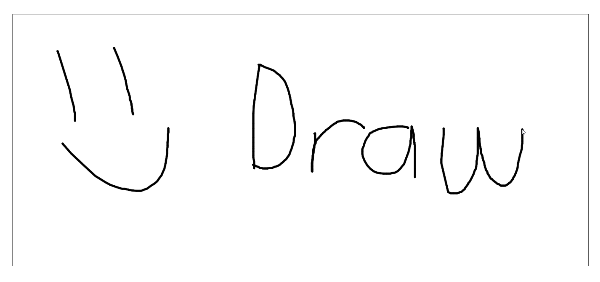

# Web Based Drawing App

This is a web based drawing application that uses **`HTML`**, **`CSS`** and **`JavaScript`** to allow you to draw anything you like on the web. Choose drawing colors with the HSV color wheel or its brightness, hue, and saturation sliders. Save the current canvas as a PNG and choose its file location in browsers that support the File System Access API.

[Click here](https://sudipt1999.github.io/drawing-app/) to start drawing.



## Contributing

If you would like to make this project amazing feel free to contribute. There are so many features that could be added to this project to make it better.

* Add erase functionality
* Add fill funtionality
* Add different colors
* And much more...

This was a college project, so I only have the funtionality required for the project, but I would love to see this project get better.

## Trick-or-Treat Pictionary (hackathon fork)

Pick **Treat** (spooky) or **Trick** (cheeky): an image shows for 6 seconds, then you draw it from memory before the timer runs out and compare yours to the original.

**Images:** the folder an image is in is its category.

```
assets/pixabay/treat/      spooky images (Treat button)
assets/pixabay/trick/      cheeky images (Trick button)
assets/pixabay/credits.json  Pixabay credit per image id
assets/pixabay/cache.js    generated, don't edit by hand
```

To curate, use Finder, then run `node scripts/build-pixabay-cache.js` (no key needed):
- **Bad image:** delete the file. It won't be downloaded again.
- **Wrong category:** drag it into the other folder.
- **Your own image:** drop a .png/.jpg into a folder. The file name is the prompt (`rubber-duck.png` becomes "rubber duck").

To download more: get a free key at https://pixabay.com/api/docs, `cp js/config.example.js js/config.js`, set `PIXABAY_API_KEY`, and run `node scripts/build-pixabay-cache.js --fetch`. Search terms live in `js/queries.js`, split into `treat` and `trick`.

With no image cache, the game falls back to the live Unsplash API (if `UNSPLASH_ACCESS_KEY` is set) or built-in emoji images.